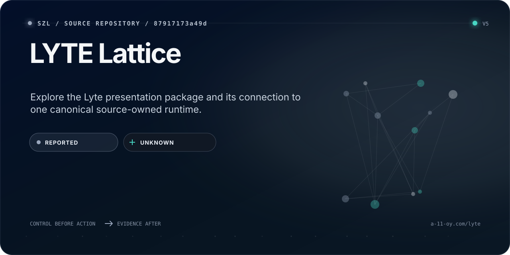

<!-- Native identity: szl-brand@4309f6fce89179331b0b3ed8c99494e76c5be256; Orbit v2 icon sha256 6e2b7d72a3af3d9602b79de41df0194ede6496a9661f057108ec224c0efc92e6. -->
<!-- Surface Foundry: szl-brand@b519affbd63447c086cb74b6e0636661bcac09a6; input README.surface.json; receipt README.surface-receipt.json. Generation metadata is not live runtime evidence. -->
<p><a href="https://github.com/szl-holdings"></a></p>

<!-- SZL-SURFACE-CARD:v3:START -->
<p align="center">
  <a href="https://a-11-oy.com/lyte">
    
  </a>
</p>

> Explore the Lyte presentation package and its connection to one canonical source-owned runtime.

| Path | What a non-technical reader gets | Where a builder starts |
| --- | --- | --- |
| **Understand** | Follow the product window, presentation source and runtime ownership. | [Open the primary surface](https://a-11-oy.com/lyte) |
| **Build** | Read the package and its delegated lyte-services backend contract. | [Inspect source](https://github.com/szl-holdings/lyte-lattice) |
| **Verify** | `REPORTED` evidence · `UNKNOWN` runtime | [Inspect evidence](https://github.com/szl-holdings/lyte-lattice/blob/0d66f873cd1be784c405842f898684334de8c713/README.md) |

<sub>BIND_AS_A11OY_PACKAGE. Runtime readback is separate; the retired standalone target stays retired. No GPU dispatch or invented energy. Λ remains Conjecture 1. A signature proves scoped integrity and origin; it does not prove accuracy, safety, performance, compliance, or authorization.</sub>
<!-- SZL-SURFACE-CARD:v3:END -->


<details>
<summary>Visual source and reproduction</summary>

This card is generated by [SZL Surface Foundry](https://github.com/szl-holdings/szl-brand/tree/b519affbd63447c086cb74b6e0636661bcac09a6) from [the reviewed source contract](https://github.com/szl-holdings/lyte-lattice/blob/main/README.surface.json). [The generation receipt](https://github.com/szl-holdings/lyte-lattice/blob/main/README.surface-receipt.json) binds its copy and SVG; it does not attest live publication or independent product verification.

At that exact brand revision, run `PYTHONPATH=src python -m szl_brand.surface /path/to/README.surface.json --output /tmp/szl-readme-card`. Copy the generated SVG to `readme-surface-card.svg` and the receipt to `README.surface-receipt.json`; update only the v3 managed block and preserve the surrounding source bytes.

Native SZL artwork is reused from its [licensed source](https://github.com/szl-holdings/szl-brand/blob/4309f6fce89179331b0b3ed8c99494e76c5be256/NOTICE) with CC BY 4.0 attribution to SZL Holdings and the source trademark reservation.

</details>

# LYTE Lattice

**Presentation package. One canonical Lyte runtime.**

BIND_AS_A11OY_PACKAGE. This repository contains the named-frontier hologram and
presentation work. It is not a second flagship, a production certificate, a
broker, a GPU cluster, or a Hub-certified trainer.

| Role | Source or surface |
| --- | --- |
| Presentation package | [szl-holdings/lyte-lattice](https://github.com/szl-holdings/lyte-lattice) |
| Canonical Python backend | [szl-holdings/lyte-services](https://github.com/szl-holdings/lyte-services) |
| Current Hub runtime | [SZLHOLDINGS/lyte](https://huggingface.co/spaces/SZLHOLDINGS/lyte) |
| Product window | [a-11-oy.com/lyte](https://a-11-oy.com/lyte) |
| Canonical publisher | [A11oy hf-sync](https://github.com/szl-holdings/a11oy/blob/main/.github/workflows/hf-sync.yml) |
| Proof origin | [a11oy.net](https://a11oy.net) |
| Authority manifest | [estate/alignment.v1.json](https://github.com/szl-holdings/.github/blob/main/estate/alignment.v1.json) |

## Source → runtime

A11oy's `scripts/hf_publish_vertical_flagships_v4.py` delegates Lyte to
`scripts/hf_publish_lyte_enterprise.py`. That publisher binds an exact
`lyte-services` revision and publishes the existing `SZLHOLDINGS/lyte` Space.
The source-owned Python runtime must not be replaced by a generic generated shell.

The older `SZLHOLDINGS/lyte-lattice` standalone target and central
`publish-operator-spaces.yml` lane are retired. Do not recreate them.
The historical `.github/workflows/hf-deploy.yml` filename now holds a **read-only
authority verifier**, not a provider writer. It checks the estate manifest,
backend/Space ownership, and matching immutable publisher pins, then records the
exact inspected commits. The reviewed current publisher resolves one signed,
immutable backend commit with all 17 source checks passing on that same commit.
The verifier admits this resolver only when the publisher and entrypoint match
their reviewed Git blobs, independently verifies the public source evidence,
and rechecks the backend tip before recording its receipt. An unreviewed
publisher change or incomplete evidence fails closed. A passing authority check is **not** a runtime uptime
or byte-parity claim; those require the canonical publisher's live evidence.

## Named frontiers

The package retains the N1–N27 frontier interfaces: serving, graph orchestration,
guards, memory, retrieval, evaluation, energy, tools, policy, voice, identity,
and research/training views. Their holographic interfaces do not grant execution
or promotion authority. Optional integrations must report unavailable rather
than simulate a working provider.

N26 inference is REPORTED; do not invent measured joules. N27 GPU training is
UNAVAILABLE without admitted CUDA execution. The gpu-bridge remains
NEVER_DISPATCH. Energy stays UNAVAILABLE unless a real RAPL `energy_uj` sample
is read; watts are not a substitute for integrated energy. Occupancy is
UNAVAILABLE without observations; this is not an MLS.

Hash receipts are not independent signatures. Λ remains **Conjecture 1**.
Owner order `AO-2026-08-29-001` admits this as an A11oy package, not a second flagship.
`a11oy.com` is not an SZL product origin.

## Develop

```bash
npm ci
npm run dev
# Compile the presentation without a database migration:
npm run build:dev
# Complete offline regression suite (Node 22.6+):
npm test
# Offline authority regression tests:
python scripts/test_hf_ownership.py
```

Optional completion integrations use server-side configuration. An absent key
is an unavailable capability, never a mock success. Keep credentials out of
source, browser bundles, and evidence receipts.

`npm test` discovers script tests without shell globs and also runs the auth,
connector, completion-request and streaming suites. Missing suites and child
process failures fail the command. CI runs this complete suite on Node 22;
the build matrix remains Node 20 and 22. Brand asset maintenance is documented
in [docs/brand-assets.md](docs/brand-assets.md).

Set `XAI_API_KEY` on the application server to use the completion integration.
The model is pinned to `grok-4.7` (`DEFAULT_GROK_MODEL` in
`src/lib/grok-contract.ts`; every label derives from it). The server-side
`SZL_GROK_MODEL` may select only an id in `ALLOWED_GROK_MODELS` (the pin, or
`grok-4.5` as the rollback target); a blank value counts as unset. `XAI_MODEL` is a
deprecated fallback read only when `SZL_GROK_MODEL` is unset, under the same
allowlist. Any other value makes the integration unavailable before any
provider call; it never falls back silently. xAI documents that its reasoning
models reject `stop`, `presence_penalty` and
`frequency_penalty`, so none of these is sent for any model. A profile's stop sequences
(TensorRT-LLM: three newlines) are applied to the returned text on the server
instead. Requests have a 60-second provider
deadline, at most 32 messages and 32,000 prompt characters. Conversation requests
retain the current prompt and instructions, dropping oldest history as needed
to fit that budget. The stream reports
success only after the provider's completion event; disconnects, malformed
events, and empty completions report an error. No provider key or paid inference
is required for the regression suite:

```bash
node --experimental-strip-types --test src/lib/grok-contract.test.ts src/lib/completion-history.test.ts
```

Apache-2.0 · Doctrine v11 LOCKED · Copyright 2026 SZL Holdings.
